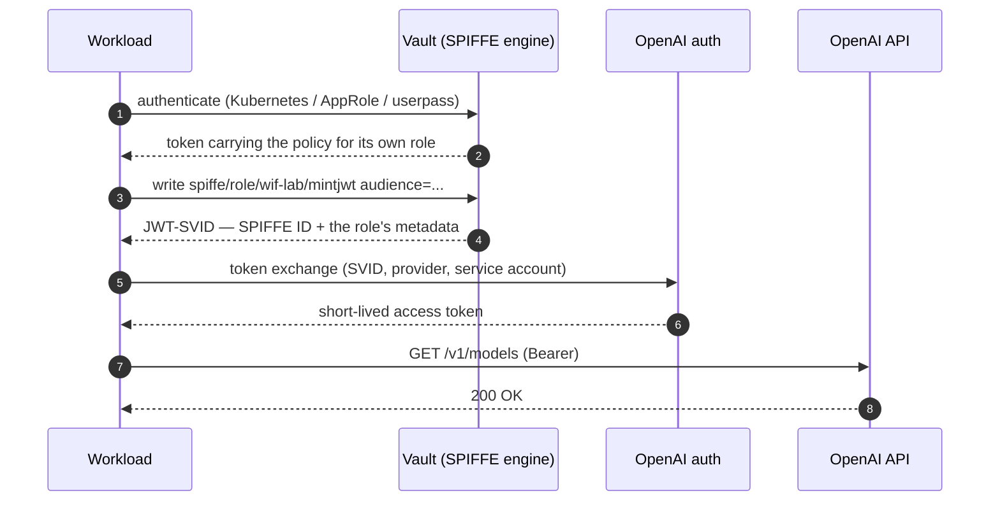

# Vault → OpenAI Workload Identity Federation — probe

Testing whether **HashiCorp Vault can act as the identity provider for OpenAI's
Workload Identity Federation**, the way it can for Anthropic's. Vault issues the subject
token with the **SPIFFE secrets engine** (Vault Enterprise), which mints a **JWT-SVID**
whose claims come from the role.

This is a probe, not a product. The end goal is to prove the whole loop: a workload asks
Vault to mint a JWT-SVID, OpenAI recognises it and returns a short-lived credential, and
the workload uses that credential to call the API and consume tokens — with no static API
key anywhere in the chain.

## Why this is interesting

Both providers do the same thing — exchange a short-lived IdP JWT for a short-lived
platform token, so no static API key exists in the workload. They diverge on who may
be the IdP:

| | Anthropic | OpenAI |
|---|---|---|
| Custom OIDC issuer | any standards-compliant issuer | documented providers only; otherwise *"contact OpenAI support"* |
| Grant | RFC 7523 `jwt-bearer` | RFC 8693 token exchange |
| Rule selection | client names the rule ID | server resolves exactly one matching mapping |
| Config API | — | dashboard only (no Admin API, no Terraform resource) |

Vault is not on OpenAI's provider list. So the question is whether "not supported yet"
means *rejected* or merely *undocumented*.

## The flow at a glance



## Run it

Everything runs in Podman. Nothing is installed or run on the host.

Create `.env` first — `run-vault.sh` needs a root token and a readable Enterprise
licence file:

```bash
cp .env.example .env
TOKEN=$(openssl rand -hex 24)
printf 'VAULT_DEV_ROOT_TOKEN=%s\nVAULT_TOKEN=%s\n' "$TOKEN" "$TOKEN" >> .env
# appending is fine — later assignments win when the file is sourced
# then set VAULT_LICENSE_FILE in .env to a real .hclic on this machine
```

Then, in order:

```bash
./run-vault.sh       # Vault ENTERPRISE 2.1.2 container -> http://127.0.0.1:8200
./setup-vault.sh     # SPIFFE engine + ONE role/policy per workload, writes out/jwks.json
./mint-token.sh      # STEP 1  Vault mints the SPIFFE JWT-SVID
./exchange.sh        # STEP 2  OpenAI recognises it, returns the credential
./use-token.sh       # STEP 3a client authenticates, spends nothing
./use-token.sh --consume   # STEP 3b client consumes tokens (metered)
./exchange-team.sh <workload> <service-account-id>   # STEP 2 for any workload
./snippets/wif-end-to-end.sh   # the whole client flow in one screen (the deck slide)
./stop-vault.sh      # remove the container
```

## What each step proves

| Step | Proves | Cost |
|---|---|---|
| 1 `mint-token.sh` | Vault can mint a SPIFFE JWT-SVID shaped the way OpenAI requires | free |
| 2 `exchange.sh` | OpenAI **accepts** that JWT and mints a credential for the mapped service account | free |
| 3a `use-token.sh` | the credential actually authorises against the API (`GET /v1/models`) | free |
| 3b `use-token.sh --consume` | the credential can spend — one minimal inference call | **metered** |

Step 3 is split deliberately. A `200` from `GET /v1/models` already proves the
Vault-derived credential is accepted end to end, and it needs no credit on the org.
Only 3b costs money, so it is opt-in. If you are testing on a personal org with no
billing set up, stop at 3a — the loop is proven.

Step 3b needs `OPENAI_MODEL` set in `.env`, and **only the model the project's allowlist
permits will work** — in this lab that is `gpt-4o` alone. Picking any other model from
the list `use-token.sh` prints returns a `403`, which is the allowlist working, not a
WIF failure.

One thing that can fail at 3a even when 2 succeeded: **authorisation**. If the mapping
defines no Permissions, the credential inherits the service account's project roles — so
the service account needs a role covering the endpoint you call. A `403` there is a
role problem, not a WIF problem; a `401` means the credential itself was rejected.

`run-vault.sh` uses `hashicorp/vault-enterprise:2.1.2-ent` — the current release. Bump
the tag in that script when a newer one lands.

**Enterprise is required, and the licence is checked twice.** The SPIFFE secrets engine
is an Enterprise feature, so the community image cannot mint a JWT-SVID. `run-vault.sh`
runs `vault license inspect` on the file **before** starting the server (signature,
format, expiry — it fails loudly on a bad file), then confirms from
`/v1/sys/license/status` that the running server autoloaded it and that the entitlement
list contains **SPIFFE Secrets Engine**. The licence is mounted read-only from wherever
it already lives; `*.hclic` is gitignored so it cannot be committed by accident.
(Measured 2026-10-10 on v2.1.2+ent: licence autoloaded, 22 features, SPIFFE entitled.)

Dev mode means in-memory storage and an auto-unsealed server, so **state is lost when
the container is removed**; `run-vault.sh && setup-vault.sh` rebuilds it in seconds.
That is the right trade here, because the thing under test is the JWT's issuer and
claims, not Vault's storage or HA story.

## Does this need ngrok?

Only if you use OIDC **discovery**. OpenAI can be given Vault's keys two ways:

| Mode | Does OpenAI fetch anything? | Public exposure needed? |
|---|---|---|
| **Uploaded JWKS** | No — you paste the key set; the issuer URL is only compared as a string against the `iss` claim | **No** |
| **OIDC discovery** | Yes — `https://<issuer>/.well-known/openid-configuration`, then the `jwks_uri` | **Yes** — OpenAI requires public HTTPS and rejects a custom port |

So the probe can run either way. The SPIFFE engine exposes the same two endpoints:
`<issuer>/.well-known/openid-configuration` and `<issuer>/.well-known/keys`. If OpenAI
rejects `http://127.0.0.1:8200/v1/spiffe` as an issuer string, that is itself the finding,
and the tunnel is the fallback (below).

## The two manual clicks

OpenAI has **no API and no Terraform resource** for these two objects — nothing in their
documented reference creates a Workload Identity Provider or a mapping. This is the only
non-scriptable part of the flow.

1. **platform.openai.com → Settings → Organization → Security → Workload Identity Provider**
   - **OIDC Issuer URL**: what `setup-vault.sh` printed — the SPIFFE issuer,
     `<VAULT_API_ADDR>/v1/spiffe`
   - **Audience**: the value of `OPENAI_AUDIENCE`, default `https://api.openai.com/v1`.
     This is the `audience` passed at mint time.

   These are **two different fields**. The Audience is *not* the issuer URL — swapping
   them yields `invalid_subject_token`, which surfaces far from the actual mistake.
   - Enable **"Use uploaded JWKS for token verification"** and paste `out/jwks.json`
     (this is what avoids the public-HTTPS discovery fetch)
   - Record the provider ID → `OPENAI_IDENTITY_PROVIDER_ID`
2. **Project → Service accounts → create**, then on the provider page **Create mapping**
   targeting that service account. Match on the role's **business claims** — `project`,
   `cost_centre`, `bu`. `sub` is now a stable SPIFFE ID
   (`spiffe://<trust-domain>/<path>`), so it is safe to match on too, but `project` keeps
   the mapping readable and independent of the trust domain.
   - Record the service account ID → `OPENAI_SERVICE_ACCOUNT_ID`

`+ Add` in the mapping dialog adds another *claim condition* to that mapping. To use
another project you need another **mapping**, via `+ Create mapping` — a mapping always
targets exactly one project and one service account.

Both IDs then go into the `.env` you created above (`OPENAI_IDENTITY_PROVIDER_ID`,
`OPENAI_SERVICE_ACCOUNT_ID`).

## One issuer, one role per workload

`setup-vault.sh` creates **one SPIFFE role and one policy per workload**. The role
template carries that workload's metadata as **literal claims**, so the SVID is built
from the role and needs no identity entity at all. The policy is the gate: it permits
`spiffe/role/<role>/mintjwt` for that workload's role and nothing else — so a workload
can only ever present its own metadata.

Adding a workload is one line in the `WORKLOADS` array, plus one mapping on the OpenAI
side. The engine config (trust domain, issuer) does not change.

```
Vault (1 issuer, 1 trust domain)
  ├── role wif-lab         project=sea-change · cost_centre=CC-IB-4471 · bu=Institutional Banking
  ├── role team-payments   project=payments   · cost_centre=CC-RB-2210 · bu=Retail Banking
  └── OpenAI provider "Vault Lab"        ← one, points at Vault
        ├── mapping sea-change  project=sea-change · cost_centre=CC-IB-*  → SA-A in "sea-change"
        └── mapping payments    project=payments                          → SA-B in "payments"
```

Each workload authenticates with whatever method it already uses (the lab uses userpass
as a stand-in) and its policy binds it to its role. Measured 2026-10-10: both workloads
mint their own SVID; `team-payments` asking for `spiffe/role/wif-lab/mintjwt` is refused
with `permission denied`.

The policy grants `capabilities = ["create", "update"]` — Vault's documented default for
a write path: *"very few parts of Vault distinguish between create and update, so most
operations require both"*, and the SPIFFE docs note no exception. Measured on 2.1.2-ent,
`update` alone is actually enough to mint (`200` on PUT and POST) while `create` alone
gets `403`, but that is undocumented behaviour, so both stay in the policy.

### The mapping authorises — it does not route

This is the part that is easy to get wrong. `service_account_id` is a **required field in
the token exchange request**, so **the client names the service account it wants**.
OpenAI then resolves mappings for that `(provider, service_account_id)` pair and checks
the claims against them:

> OpenAI looks up mappings for the requested `identity_provider_id` and
> `service_account_id` … and issues a token only if exactly one enabled mapping matches
> every configured attribute.

So a claim does not *select* a project. The workload declares its target service account
(a per-workload config value) and the mapping is the gate that says yes or no. The
practical upshot is that workloads are isolated from each other by default — a security
control as much
as an attribution one.

### Demo the matrix

```bash
./exchange-team.sh wif-lab        "$OPENAI_SERVICE_ACCOUNT_ID"            # SUCCESS
./exchange-team.sh team-payments  "$OPENAI_SERVICE_ACCOUNT_ID_PAYMENTS"   # SUCCESS
./exchange-team.sh wif-lab        "$OPENAI_SERVICE_ACCOUNT_ID_PAYMENTS"   # REJECTED
./exchange-team.sh team-payments  "$OPENAI_SERVICE_ACCOUNT_ID"            # REJECTED
```

Measured 2026-10-10: both same-workload pairs succeed and return the expected project and
service account; both crossed pairs fail with `invalid_grant`. The script prints the
resolved project and service account, so you can verify all four without trusting this
line — the commands above are the test.

`OPENAI_SERVICE_ACCOUNT_ID_PAYMENTS` and `OPENAI_PROJECT_ID_PAYMENTS` in `.env` record
the second workload's mapping targets. Only the service account is consumed by
`exchange-team.sh`; the project ID is kept for reference so you can tell which project
the service account belongs to without opening the dashboard.

**Ceiling:** 50 Workload Identity Providers per organisation, and 50 service account
mappings per provider — documented in the token-exchange reference's *Limitations*
section (https://developers.openai.com/api/reference/workload-identity-federation). One
provider therefore covers up to 50 `(project, service account)` targets before a second
provider is needed.

## Verified: what Vault actually issues

Measured against Vault v2.1.2+ent in Podman, not read off a doc page. `./mint-token.sh`
prints the live token; this is what it looked like with the ngrok tunnel as the issuer:

```json
{
  "aud": ["https://api.openai.com/v1"],
  "bu": "Institutional Banking",
  "cost_centre": "CC-IB-4471",
  "exp": 1791604183,
  "iat": 1791603583,
  "iss": "https://<tunnel-host>/v1/spiffe",
  "jti": "<token-id>",
  "nbf": 1791603583,
  "project": "sea-change",
  "sub": "spiffe://lab.example.org/sea-change/wif-lab",
  "vault": { "entity": { "id": "<entity-id>" } }
}
```

Things that cost time to work out:

- **The issuer is the SPIFFE engine config, not `api_addr`.** `jwt_issuer_url` in
  `spiffe/config` becomes the `iss` claim verbatim; `setup-vault.sh` sets it to
  `${VAULT_API_ADDR}/v1/spiffe`. Set it explicitly rather than relying on the engine
  default, so OpenAI and Vault agree on the exact `iss` string.
- **The role template must be quoted.** The SPIFFE engine parses the template as
  JSON *before* expanding it, so a literal that is not inside quotes is rejected with
  `invalid template: role template is not a valid JSON object`. These are literal values
  anyway (`"project":"sea-change"`), not identity directives — the metadata lives in the
  role, so there is nothing to expand.
- **Minting does not require an entity.** The claims come from the role, so any token
  with the right policy can mint. `./mint-token.sh` still logs in, which adds a
  `vault.entity.id` to the SVID, but nothing depends on it.
- **`aud` is a request parameter, not role config.** Pass `audience=<value>` to
  `spiffe/role/<role>/mintjwt`; Vault puts it in `aud` as a list. It must equal the
  Audience field on the OpenAI provider.
- **`sub` must be a valid SPIFFE ID.** The template's `sub` is required; a bare path is
  prefixed with the configured trust domain, so `"/sea-change/wif-lab"` renders as
  `spiffe://lab.example.org/sea-change/wif-lab`.
- JWKS: `<issuer>/.well-known/keys`. Discovery: `<issuer>/.well-known/openid-configuration`.
  Both are served by the SPIFFE engine and reachable over the tunnel.
- `kid` and `alg: RS256` are present, and `iss/aud/sub/exp/iat` are all present — the
  claim set OpenAI documents as mandatory.
- **Credential lifetime is doubly bounded** (both documented): OpenAI caps access tokens
  at **one hour**, and *"a JWT exchange token never outlives its external subject token"*.
  So the Vault role TTL is the binding constraint whenever it is under an hour. Observed
  locally across role TTLs of 2m, 5m, 10m and 30m, with `expires_in` tracking each; the
  10m case is the one recorded in `out/exchange.json` (598s).
- **Wildcards are prefix-only** (documented): one trailing `*`, non-empty prefix, no bare
  `*`, no infix, no regex. Observed locally against a mapping value of `CC-IB-*`:
  `CC-IB-4471` and `CC-IB-9999` accepted, `CC-RB-4471` rejected. The bare prefix `CC-IB-`
  also matched — OpenAI requires a non-empty *prefix* but says nothing about a non-empty
  suffix, so treat that as prefix semantics rather than a documented guarantee.
- **Only two values in the resulting credential originate from Vault**:
  `wif_external_subject` and `wif_external_issuer`. Everything else is OpenAI's own
  bookkeeping. `sub` in the credential is the *service account*, so "who spent this" is
  answered by `wif_external_subject`, which is the SVID `sub` — the SPIFFE ID.
- **No revocation on this path.** The API-path guide documents no way to revoke an
  already-issued access token; disabling a provider or mapping blocks *new* exchanges.
  The Codex federation-rules path is different — there, disabling a rule or provider
  *"revokes OpenAI access tokens issued through it"*. Expiry is the only bound here, so
  keep the role TTL short.

## What OpenAI hands back

The exchange returns a short-lived access token — also a JWT, but signed by OpenAI. Only
two of its claims came from Vault; everything else is OpenAI's own bookkeeping. Decoded
from a live exchange (`./exchange.sh` prints this; identifiers are redacted):

```json
{
  "iss": "https://auth.openai.com",
  "sub": "<service-account-id>",
  "aud": "https://api.openai.com/v1",
  "iat": 1791611824,
  "nbf": 1791611824,
  "exp": 1791612423,
  "jti": "<token-id>",
  "https://api.openai.com/auth": {
    "user_id": "<service-account-id>",
    "organization_id": "<org-id>",
    "project_id": "<project-id>",
    "api_organization_id": "<org-id>",
    "api_project_id": "<project-id>",
    "wif_product": "api",
    "wif_identity_provider_id": "<provider-id>",
    "wif_federation_rule_id": "<mapping-id>",
    "wif_external_subject": "spiffe://lab.example.org/sea-change/wif-lab",
    "wif_service_account_id": "<service-account-id>",
    "wif_external_issuer": "https://<tunnel-host>/v1/spiffe",
    "wif_provider_revision": "v1:<hash>",
    "wif_mapping_revision": "v1:<hash>"
  }
}
```

Claim by claim, who put it there:

| Claim | Belongs to | What it is |
|---|---|---|
| `iss` | OpenAI | `https://auth.openai.com` |
| `sub` | OpenAI | the service account |
| `aud` | OpenAI | `https://api.openai.com/v1` |
| `wif_identity_provider_id` | OpenAI | their provider record that points at Vault |
| `wif_federation_rule_id` | OpenAI | their mapping record |
| `wif_service_account_id` | OpenAI | the service account |
| `wif_product` | OpenAI | `"api"` |
| `organization_id` / `project_id` | OpenAI | org + project |
| `wif_provider_revision` / `wif_mapping_revision` | OpenAI | version hashes of their config |
| `wif_external_subject` | **Vault** | the SPIFFE ID (the SVID `sub`) — which workload asked |
| `wif_external_issuer` | **Vault** | Vault's SPIFFE issuer URL — which issuer vouched |

`./exchange-team.sh <workload> <service-account-id>` prints just the interesting part:
the resolved project, the service account, and `wif_external_subject`.

## The failure modes, and how to tell them apart

| Symptom | Meaning |
|---|---|
| No *Workload Identity Provider* in Organization Settings | account/plan gating on a personal org |
| `invalid_subject_token` — issuer or audience mismatch | config error; check `iss` and `aud` above |
| Issuer rejected outright | the arbitrary-issuer gap: Vault is not a supported provider |
| `invalid_grant` — mapping resolution | no enabled mapping matched, or more than one did |

## If the issuer is rejected

Give Vault a public HTTPS identity so the `iss` claim is one OpenAI will accept:

1. Tunnel `127.0.0.1:8200` (cloudflared / ngrok).
2. Set **`VAULT_API_ADDR=https://<tunnel-host>` in `.env`**, then `./run-vault.sh` again.
   The issuer becomes `https://<tunnel-host>/v1/spiffe` (or set `SPIFFE_ISSUER_URL`
   directly to override it).

   Note: `run-vault.sh` regenerates `out/vault.hcl` from `.env` on every start and mounts
   only that generated file, so **editing the tracked `vault.hcl` has no effect** — it is
   silently overwritten. `.env` is the knob.
3. Re-run `setup-vault.sh`, update the issuer in OpenAI, and either re-upload
   `out/jwks.json` or switch the provider to OIDC discovery.

Use a **stable** hostname. A free quick tunnel gets a new random name on every restart,
which changes the `iss` claim and forces you to update the provider each time — and
OpenAI caches discovery and JWKS for 600 seconds.

## Findings

Recorded as the probe runs.

- 2026-10-08 — Vault-side issuer, JWKS and claims verified on v2.1.2 in Podman.
- 2026-10-08 — **The exchange works.** OpenAI accepted a Vault-issued JWT and minted a
  credential, and `GET /v1/models` returned `200` with `gpt-4o` visible. Vault is
  therefore *undocumented but accepted* — the "documented providers only" wording in
  OpenAI's guide is a limitation of their documentation, not an enforced gate. This is
  the finding the probe set out to establish.
- 2026-10-08 — A wrong claim value is refused. Breaking `cost_centre`, then `bu`, each
  produced `invalid_grant` with the other attributes correct — so multiple attributes in
  one mapping really are AND-ed. (Observed interactively; the AND semantics are also
  documented.)
- 2026-10-10 — **Converted to Enterprise + SPIFFE.** Licence validated offline
  (`vault license inspect`: signature/format valid) and again from the running server
  (`/v1/sys/license/status`: autoloaded, SPIFFE Secrets Engine entitled). JWT-SVIDs minted
  with role-defined metadata (`project`, `cost_centre`, `bu`) and a public tunnel issuer.
  Per-workload mint policies verified: each workload mints only its own role; cross-role
  mint returns `permission denied`.
- 2026-10-10 — **The SPIFFE loop works end to end.** After re-pointing the OpenAI provider
  at `<issuer>/v1/spiffe`, the exchange accepted the SVID and minted a credential, and
  `GET /v1/models` returned `200` with `gpt-4o`. The credential's
  `wif_external_subject` is now the SPIFFE ID (`spiffe://lab.example.org/sea-change/wif-lab`)
  rather than an entity UUID — a more useful answer to "who spent this". The full
  four-case matrix behaves: both same-workload inputs succeed, both crossed inputs fail
  with `invalid_grant`.
- 2026-10-10 — **OpenAI documents SPIFFE support directly.** The token-exchange
  reference's *Limitations* section says *"SPIFFE support is limited to JWT-SVID subject
  tokens. X.509-SVIDs aren't supported by this token exchange endpoint"* — so a JWT-SVID
  is an accepted `subject_token_type` for this endpoint, which is exactly what the SPIFFE
  secrets engine mints. The same section confirms the gap this probe was built around:
  *"Arbitrary OIDC issuer endpoints other than the providers documented in the setup
  guides aren't supported yet."* Vault is not one of those documented providers, yet the
  exchange works — so the wording is a documentation limit, not an enforced gate.
- 2026-10-10 — **`create` is not enforced on the mint path, but the documented default is
  to grant it.** `spiffe/role/<role>/mintjwt` is a PUT/POST: an update-only token mints
  (`200` on PUT and POST) while a create-only token gets `403` on both. Because Vault's
  policy docs say most write paths need both and the SPIFFE docs note no exception, the
  policy keeps `["create", "update"]` — the same path, so the extra capability buys no
  extra reachable surface.

**Not demonstrated:** metered inference (step 3b). The recorded response is
`credit_balance_exhausted` — the org has no credit. Everything is proven through step 3a,
which needs none.

## Not in scope

- **The refresh loop.** The credential is short-lived and token exchange returns no
  refresh token, so a long-running client must re-exchange before `expires_at`. The
  probe does one exchange and one call; it does not implement the loop.
- **Metered consumption.** Step 3b is wired up but has never succeeded — the org has no
  credit. The loop is proven through authentication, not spend.
- **Revocation.** Nothing here demonstrates revoking an issued credential, because this
  path does not offer it (see above).
- **The Admin API key** (`OPENAI_ADMIN_KEY`). It can only list/read/delete admin keys,
  not create them, and it buys nothing here.

Everything up to and including step 3a is free — the exchange is an auth endpoint, so it
consumes no tokens and needs no credit on the org.
